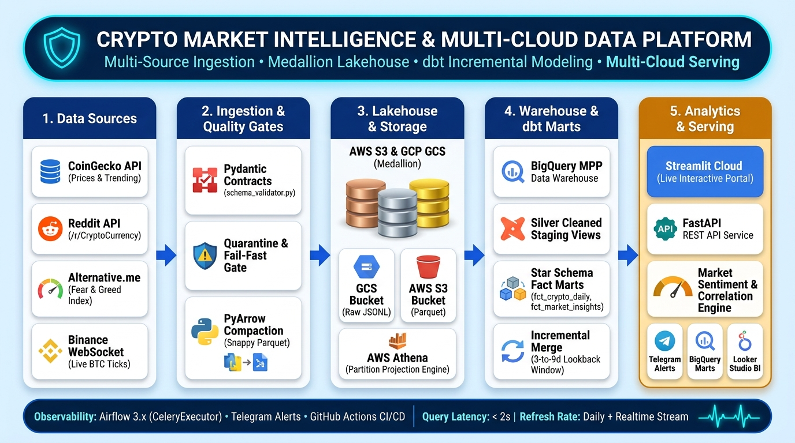

# ⚡ Crypto Market Intelligence & Multi-Cloud Data Platform

[](https://crypto-data-pipeline-binhg.streamlit.app/)
[](https://airflow.apache.org/)
[](https://www.getdbt.com/)
[](https://aws.amazon.com/)
[](https://github.com/features/actions)

An **End-to-End, Production-Inspired, Zero-Cost Multi-Cloud Data Engineering Platform** that ingests multi-source cryptocurrency market data and social sentiments (CoinGecko, Reddit, Fear & Greed Index, Trending Coins, Binance Stream), enforces Pydantic data contracts, transforms data via dbt BigQuery Incremental models with Medallion Architecture, orchestrates tasks via Apache Airflow 3.x, and serves live interactive analytics via **AWS Athena + Streamlit Cloud**.

👉 **Live Demo Dashboard**: [crypto-data-pipeline-binhg.streamlit.app](https://crypto-data-pipeline-binhg.streamlit.app/)

---

## 🏛️ High-Level System Architecture

<div align="center">
  
</div>

---

## 🏗️ Architectural Layer Breakdown Matrix

A detailed architectural breakdown following industry-standard **Medallion Data Architecture** and physical implementation specifications:

| Architectural Tier | Component & Storage | Ingestion & Load Pattern | Transformations & Logic | Data Modeling & Schema | Quality Gates & Governance |
| :--- | :--- | :--- | :--- | :--- | :--- |
| **1. Data Sources** | • CoinGecko REST API<br/>• Reddit JSON API<br/>• Alternative.me API<br/>• Binance WebSocket | Batch HTTP GET requests (Daily schedule) + Continuous Async WebSocket event stream | • Raw payload fetching<br/>• Exponential backoff retries<br/>• Rate-limit guard | Unstructured JSON payloads & WebSocket trade ticks | API HTTP status code checks, timeout guards (15s), fallback mock generation |
| **2. Ingestion & Quality Gate** | In-memory Python workers running under Airflow CeleryExecutor | Ingestion validation gate before landing on disk | • Strict type coercion<br/>• Schema drift detection<br/>• Malformed record quarantine | Pydantic BaseModels (`CoinGeckoRecord`, `RedditRecord`, `FearGreedRecord`, `TrendingCoinRecord`) | **Pydantic Data Contracts**: Quarantine pattern isolates invalid records; fail-fast halts invalid pipelines |
| **3. Bronze Layer (Data Lake)** | • **GCP GCS**: `gs://crypto-data-lake-subin/raw/`<br/>• **AWS S3**: `s3://crypto-data-lake-hg/raw/` | Append-only raw snapshots partitioned by ingestion date (`yyyy-MM-dd`) | **Compaction Engine**: Merges small JSONL files into compressed, columnar **Snappy Parquet** format | Raw JSONL and compressed Snappy Parquet (No structural transformation) | Local non-empty file assertion (`assert_non_empty_local_jsonl`) prior to Cloud upload |
| **4. Silver Layer (Cleaned & Staged)** | **GCP BigQuery**: Staging views in `crypto_transform` dataset | Loaded from GCS via BigQuery Load Jobs with `WRITE_APPEND` and schema autodetection | • Data type casting & renaming<br/>• Timestamp normalization to UTC<br/>• Duplicate removal | 1:1 Staging Entities:<br/>• `stg_coingecko`<br/>• `stg_reddit`<br/>• `stg_fear_greed`<br/>• `stg_trending_coins` | dbt automated schema tests: `unique`, `not_null` on primary IDs; non-zero row verification (`output_rows > 0`) |
| **5. Gold Layer (Curated Marts)** | **GCP BigQuery**: Tables with **Date Partitioning** (`report_date`) & **Clustering** (`coin_id`) | **Incremental Merge** (`incremental_strategy='merge'`, `unique_key='record_id'`) with 3-to-9-day lookback window | • Surrogate key generation<br/>• 7-day rolling average price<br/>• 7-day rolling Reddit posts<br/>• Pearson Correlation (`CORR`)<br/>• Composite Sentiment Score (70% F&G + 30% Reddit) | **Kimball Star Schema**:<br/>• `dim_coin` (Dimension)<br/>• `dim_date` (Dimension)<br/>• `fct_crypto_daily` (Fact)<br/>• `fct_market_insights` (Fact) | **56 dbt automated tests**: `accepted_range` (price > 0, sentiment 0-100), referential integrity `relationships`, singular spike tests |
| **6. Serving & Consumption** | • **Streamlit Cloud** (Live Dashboard)<br/>• **AWS Athena** (Serverless Ad-hoc)<br/>• **FastAPI** (REST API) | Serverless ad-hoc SQL execution via **PyAthena** with asynchronous session caching | Direct aggregation & visualization of Gold Marts; low-latency REST endpoints | Presentation-ready metrics, KPI scorecards, price-sentiment correlation plots | PyAthena query cache, connection retries, sub-second dashboard rendering |

---

## 💎 3-Tier Medallion Data Architecture Highlights

1. **Bronze Layer (Raw Data Lake Zone)**:
   * **Raw JSONL Snapshots**: Preserves immutable raw API responses (`coingecko/`, `reddit/`, `fear_greed/`, `trending_coins/`) for auditing and full historical backfill replayability.
   * **Data Lake Compaction Engine**: Merges small JSON files into compressed, columnar **Snappy Parquet** format for zero-latency Athena queries.
2. **Silver Layer (Cleaned & Standardized Zone)**:
   * dbt Staging Models (`stg_coingecko`, `stg_reddit`, `stg_fear_greed`, `stg_trending_coins`).
   * Handles type coercion, timestamp unification, data sanitization, and deduplication.
3. **Gold Layer (Curated Business Marts)**:
   * Star-Schema Dimensional Data Marts (`dim_coin`, `dim_date`, `fct_crypto_daily`, `fct_market_insights`).
   * Computes **Composite Sentiment Scores (0-100)** and **7-Day Rolling Price vs Reddit Activity Correlations**.

---

## 🏆 Enterprise 8-Point Production Engineering Roadmap

| Part | Production Feature | Implementation Details | Status |
| :--- | :--- | :--- | :---: |
| **Part 1** | **Incremental ETL & Idempotency** | `incremental_strategy='merge'`, `unique_key='record_id'`, 3-day Lookback Window | ✅ **Production** |
| **Part 2** | **Data Quality Suite** | 56 automated dbt tests (`not_null`, `unique`, `accepted_range`, `relationships`) | ✅ **Production** |
| **Part 3** | **Schema Drift Guard** | Pydantic Data Contract & Quarantine Pattern (`utils/schema_validator.py`) | ✅ **Production** |
| **Part 4** | **Real-time Alerting** | Telegram Bot HTML instant failure dispatching via Airflow `on_failure_callback` | ✅ **Production** |
| **Part 5** | **Unified Secrets Manager** | GCP/AWS Secrets Manager with zero-cost local `.env` fallback (`secrets_manager.py`) | ✅ **Production** |
| **Part 6** | **CI/CD Quality Gates** | GitHub Actions (`black`, `flake8`, `pytest`, `dbt parse`, Continuous Deployment) | ✅ **Production** |
| **Part 7** | **Historical Backfill Strategy** | `utils/backfill.py` CLI & Airflow Native Time-Traveler Backfill Engine | ✅ **Production** |
| **Part 8** | **Performance & Storage Tuning** | BigQuery Date Partitioning, `coin_id` Clustering & Parquet Compaction Engine | ✅ **Production** |

---

## 💻 Tech Stack & Infrastructure

* **Languages**: Python 3.11, SQL (BigQuery/Athena Dialects), Bash
* **Data Processing & Analytics**: Pandas, PyArrow, Plotly, PyAthena
* **Orchestration**: Apache Airflow 3.x (Docker Compose / Celery Executor)
* **Transformation & Quality**: dbt Core 1.11, Pydantic 2.x, Pytest
* **Data Lake & Warehouse**: AWS S3, AWS Athena, AWS Glue, GCP BigQuery
* **Dashboard Serving**: Streamlit Community Cloud (Live 24/7 Deployment)
* **DevOps & MLOps**: Docker, GitHub Actions, Telegram API

---

## 📁 Repository Structure

```text
├── .github/workflows/   # GitHub Actions CI/CD Pipeline (Linting, Pytest, dbt parse, CD)
├── config/              # Centralized Settings & Multi-Coin API Configurations
├── crypto_transform/    # dbt Core Project (Staging, Marts, Schema Quality Tests)
├── dags/                # Apache Airflow 3.x Orchestration DAGs
├── dashboard/           # Streamlit Live Analytics Dashboard (app.py & requirements.txt)
├── docs/                # System Architecture, Upgrade Summary & Operational Runbook
├── ingestion/           # Data Ingestion Engines with Pydantic Schema Guards
├── tests/               # Automated Pytest Suite for Data Contracts & Alerts
├── utils/               # Central Utilities (Alerts, Backfill, Compaction, Secrets)
└── warehouse/           # AWS Athena DDLs & Glue Crawler Setup Scripts
```

---

## 🚀 Quick Start Guide

### 1. Clone & Set Up Environment
```bash
git clone https://github.com/BinHG05/crypto-data-pipeline.git
cd crypto-data-pipeline
python -m venv .venv
source .venv/bin/activate
pip install -r requirements.txt
```

### 2. Configure Environment Secrets
Copy template credentials and update AWS, Telegram, or GCP values:
```bash
cp .env.example .env
```

### 3. Launch Airflow Container Services
```bash
docker compose up -d
```
*Access Airflow Web UI at*: `http://localhost:8080` (Credentials: `airflow` / `airflow`)

### 4. Execute dbt Incremental Transformations & Tests
```bash
docker compose exec airflow-scheduler bash -c "cd /opt/airflow/crypto_transform && dbt run && dbt test"
```

### 5. Launch Streamlit Local Dashboard
```bash
streamlit run dashboard/app.py --server.port 8501
```
*Access Local Dashboard at*: `http://localhost:8501`

---

## 📚 Project Documentation

* 📄 **[Production Upgrade Summary](docs/production_upgrade_summary.md)**: Detailed breakdown of the 8 production architecture stages.
* 📘 **[Operational Runbook](docs/operational_runbook.md)**: Standard Operating Procedures (SOP) for daily operations, alerts, backfilling, and maintenance.

---

## 🔗 Live Production Links
* **Streamlit Live Dashboard**: [https://crypto-data-pipeline-binhg.streamlit.app/](https://crypto-data-pipeline-binhg.streamlit.app/)
* **Repository**: [https://github.com/BinHG05/crypto-data-pipeline](https://github.com/BinHG05/crypto-data-pipeline)
